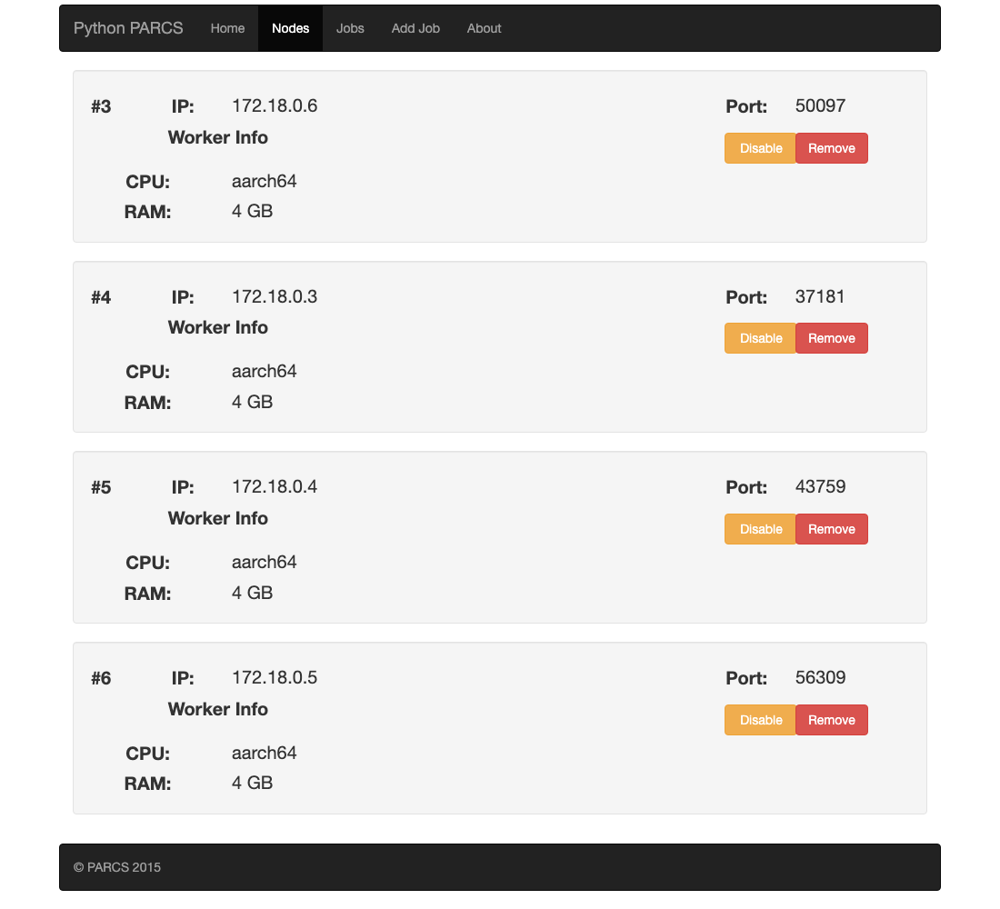
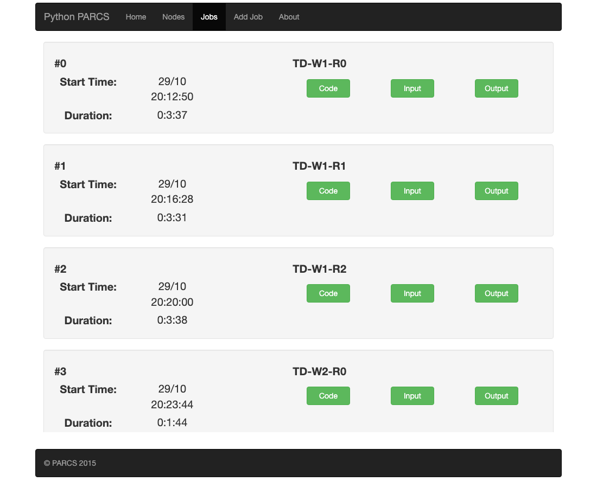
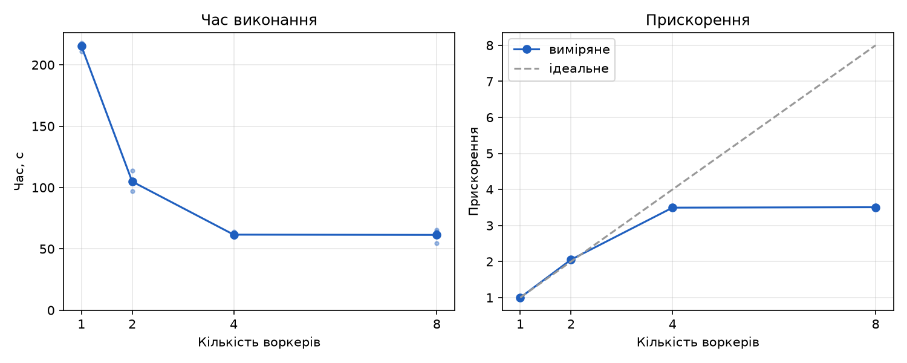

# Факторизація методом пробних дільників у PARCS-Python

Лабораторна робота № 1 з дисципліни «Хмарні обчислення».
Тема 6.3 — факторизація методом пробних дільників. Платформа — PARCS-Python,
розгортання — Docker-кластер (master + N worker) локально та в Google Compute Engine.

- Код розв'язку: [`solution.py`](solution.py)
- Виправлений PARCS-Python (Dockerfile, залежності): [`parcs-python/`](parcs-python/)
- Скрипти: [`benchmark.py`](benchmark.py), [`plot.py`](plot.py), [`gcp/`](gcp/)
- Результати: [`results/`](results/)

## 1. Ідея алгоритму

### Послідовний варіант

Метод пробних дільників перевіряє кандидатів d = 2, 3, 5, 7, … доти, поки d² ≤ n.
Якщо n ділиться на d, то d — простий множник (усі менші прості вже поділені),
його виносять, n зменшується, а межа √n зменшується разом з ним. Те, що
залишилось від n після перевірки всіх кандидатів до √n, — просте число (або 1).
Складність — O(√n) ділень; для добутку двох близьких простих p·q (найгірший
випадок) потрібно перебрати всі непарні кандидати до p.

### Паралельний варіант

Перевірка кожного кандидата не залежить від інших, тому діапазон кандидатів
можна різати на шматки і перевіряти їх на різних вузлах.

1. **Master** читає список чисел. Для кожного n він спочатку виносить двійки
   (щоб далі перевіряти лише непарні кандидати), рахує межу `isqrt(n)` і ріже
   діапазон `[3, isqrt(n)]` на шматки по `CHUNK = 2 000 000` непарних
   кандидатів (≈0,4 с роботи). Шматки всіх чисел стають у одну чергу
   «по колу»: k-й шматок кожного числа йде перед (k+1)-м шматком будь-якого.
2. **Worker** отримує `(n, lo, hi)` і повертає всі непарні d з `[lo, hi)`,
   для яких `n % d == 0`. Це єдина функція, яка виконується на робочому вузлі
   (`find_divisors`, позначена `@expose`).
3. **Динамічний розподіл.** Master викликає воркерів асинхронно (Pyro4
   повертає future), тримає по одному активному шматку на кожного воркера і,
   щойно якийсь воркер звільнився, віддає йому наступний шматок із черги.
   Ніхто не чекає на інших, навантаження вирівнюється саме собою.
4. **Збирання результату.** Отримані дільники master сортує і ділить n по
   зростанню. Складений дільник (наприклад 15 = 3·5) теж буде повернений, але
   до моменту, коли черга дійде до нього, 3 і 5 уже винесені, тому `n % 15 != 0`
   і він пропускається. Коли всі шматки числа перевірені, залишок n > 1
   додається як останній простий множник.
5. **Відсікання.** Після знайденого множника межа √n зменшується, і шматки, що
   починаються за новою межею, видаляються з черги. Шматки, які вже виконуються,
   дораховуються — зайві дільники нешкідливі. Завдяки порядку «по колу» в
   момент знахідки на воркерах крутиться щонайбільше один-два шматки цього
   числа, тож марної роботи майже немає навіть на 12 воркерах.

Обсяг роботи однаковий для будь-якої кількості воркерів (той самий набір
кандидатів), тому прискорення — це просто відношення часів.
Великі числа передаються як рядки, щоб не впиратись у серіалізатор Pyro4.

### Тестові дані

`gen_input.py --count 8 --lo 200000000 --hi 500000000` детерміновано генерує
8 напівпростих чисел p·q з простими p, q з проміжку [2·10⁸, 5·10⁸) (`input.txt`).
Для них пробні дільники мають перебрати ≈1,32·10⁹ непарних кандидатів сумарно
(≈660 викликів воркерів) — це найгірший випадок для методу, тому обсяг роботи
не залежить від випадку і від кількості воркерів.

## 2. Як влаштовано PARCS-Python

Кластер складається з головного вузла (**master**, вебінтерфейс на порту 8080)
і робочих вузлів (**worker**), які реєструються на master за HTTP і раз на 5 с
перевіряються heartbeat'ом. Користувач через вебсторінку (або `POST /api/job`)
завантажує `solution.py` та вхідний файл. Master розсилає `solution.py` усім
воркерам, кожен воркер піднімає Pyro4-сервер з об'єктом `Solver`, а master
створює `Solver(workers, input, output)` і викликає `solve()`. Методи з
декоратором `@expose` викликаються на воркерах через `self.workers[i].метод(...)`;
виклик асинхронний і повертає future з полями `ready` та `value`.

## 3. Build-проблеми та як їх виправлено

Оригінальний репозиторій [Hummer12007/parcs-python](https://github.com/Hummer12007/parcs-python)
не оновлювався з 2019 року, і зібрати його «як є» вже не можна. Готовий образ
`hummer12007/parcs-node` з Docker Hub (2018 рік) досі працює на amd64-машинах
GCE, але на Apple Silicon він запускається лише через емуляцію і значно
повільніший. Тому образ зібрано заново — папка `parcs-python/` містить
оригінальний код із такими правками:

| Проблема | Прояв | Виправлення |
|---|---|---|
| `FROM debian:stretch-slim` — Debian 9 знято з підтримки, репозиторії видалено | `apt-get update` дає `404 Not Found`, `E: Failed to fetch …/dists/stretch/main/binary-amd64/Packages` | Базовий образ `python:2.7.18-slim`; apt взагалі не використовується |
| Ядро PARCS написано лише під Python 2 (`imp`, `ConfigParser`, `Queue`, `Pyro4.async` — у Python ≥ 3.7 `async` є ключовим словом і дає `SyntaxError`) | Порт на Python 3 означав би переписати ядро | Залишено Python 2.7.18 (останній 2.x) |
| `requirements.txt` без версій: сучасні Flask 2/3, Jinja2 3, Werkzeug 2, click 8, serpent 1.30.2 — лише для Python 3 | `pip install` падає: `No matching distribution found for serpent==1.30.2`, або Flask імпортується з помилкою | Зафіксовано останні версії з підтримкою 2.7: Pyro4 4.82, serpent 1.28, Flask 1.1.4, Werkzeug 1.0.1, Jinja2 2.11.3, MarkupSafe 1.1.1, itsdangerous 1.1.0, click 7.1.2, requests 2.27.1, py-cpuinfo 5.0.0 |
| `netifaces` — C-розширення, для py2.7/arm64 немає wheel, потрібен gcc і заголовки Python | збирання падає на `error: command 'gcc' failed` | `network_utils.get_ip()` переписано через `socket` (UDP-connect без надсилання даних); залежність видалено |
| `py-cpuinfo` ≥ 6 перейменував ключ `brand` на `brand_raw` | `KeyError: 'brand'` при старті вузла | Версія зафіксована і код читає будь-який із ключів із fallback на `platform.machine()` |
| Heartbeat від master до worker без `timeout` у `requests.get` | Після зупинки воркера (VM або контейнера) master «зависає» на TCP-з'єднанні до мертвої IP на ~2 хв на кожного воркера; список вузлів оновлюється лише через кілька хвилин, наступна задача стартує із затримкою | `timeout=5` у heartbeat (`parcs_py/node.py`); мертвий воркер зникає зі списку за ~20 с |
| Образ лише для amd64 | На Apple Silicon — попередження про platform mismatch і емуляція | GitHub Actions збирає multi-arch образ (amd64 + arm64) і публікує в `ghcr.io/aiavenger1/parcs-node` |

Після цього `docker build parcs-python/` проходить без apt і компілятора
приблизно за 10 секунд.

## 4. Запуск локально (Docker Compose)

```bash
git clone https://github.com/AIAvenger1/parcs-trial-division.git
cd parcs-trial-division

docker compose up -d --build --scale worker=4   # master + 4 workers
open http://localhost:8080/workers              # список вузлів

# один запуск вручну: Add Job -> solution.py + input.txt, результат у Jobs
# або весь бенчмарк (сам масштабує воркерів, 3 запуски на кожну кількість):
python3 benchmark.py --workers 1 2 4 8 --runs 3
uv run --with matplotlib python3 plot.py        # results/plot.png + results/table.md

docker compose down
```

У `docker-compose.yml` кожному контейнеру виділено рівно 1 CPU (`cpus: 1`),
тому N воркерів справді означає N ядер. Порт 8080 прив'язано лише до
`127.0.0.1`: вебінтерфейс PARCS виконує будь-який завантажений код і не має
автентифікації, тож назовні його відкривати не можна.

## 5. Розгортання в Google Cloud (Compute Engine)

Мінімально достатній пайплайн. Потрібні: акаунт GCP з увімкненим білінгом
(вистачає безкоштовного кредиту) і встановлений [gcloud CLI](https://cloud.google.com/sdk/docs/install).

```bash
# 0. вхід і проєкт
gcloud auth login
gcloud projects create parcs-lab-<ваше-прізвище>        # або існуючий
gcloud config set project parcs-lab-<ваше-прізвище>
gcloud services enable compute.googleapis.com          # потрібен увімкнений білінг
gcloud config set compute/zone europe-central2-a       # Варшава

# 1. фаєрвол: вебінтерфейс PARCS лише з вашої IP (він виконує будь-який завантажений код)
gcloud compute firewall-rules create parcs-ui --direction=INGRESS --network=default \
  --action=ALLOW --rules=tcp:8080 --source-ranges="$(curl -s https://api.ipify.org)/32" \
  --target-tags=parcs-master
# трафік між вузлами всередині VPC уже дозволений правилом default-allow-internal

# 2. master
gcloud compute instances create-with-container master \
  --machine-type=e2-small --tags=parcs-master \
  --container-image=ghcr.io/aiavenger1/parcs-node:latest \
  --container-env=PARCS_ARGS="master"
MASTER_INT=$(gcloud compute instances describe master --format='get(networkInterfaces[0].networkIP)')
MASTER_EXT=$(gcloud compute instances describe master --format='get(networkInterfaces[0].accessConfigs[0].natIP)')

# 3. воркери (без зовнішніх IP — їм потрібен лише master)
gcloud compute instances create-with-container worker1 worker2 worker3 worker4 \
  --machine-type=e2-medium --no-address \
  --container-image=ghcr.io/aiavenger1/parcs-node:latest \
  --container-env=PARCS_ARGS="worker $MASTER_INT"

# 4. перевірка: через ~1 хв усі воркери видно тут
open "http://$MASTER_EXT:8080/workers"

# 5. бенчмарк: кількість воркерів змінюємо зупинкою/запуском VM,
#    master сам прибирає зупинений воркер після пропущеного heartbeat
./gcp/scale.sh 1 && python3 benchmark.py --master "http://$MASTER_EXT:8080" --no-scale --workers 1
./gcp/scale.sh 2 && python3 benchmark.py --master "http://$MASTER_EXT:8080" --no-scale --workers 2
./gcp/scale.sh 4 && python3 benchmark.py --master "http://$MASTER_EXT:8080" --no-scale --workers 4

# 6. не забути вимкнути: видаляє всі VM і правило фаєрволу
./gcp/destroy.sh
```

Те саме одним скриптом: `WORKERS=4 ./gcp/deploy.sh` (кроки 1–3), `./gcp/scale.sh N`,
`./gcp/destroy.sh`. Замість `ghcr.io/aiavenger1/parcs-node` можна вказати
оригінальний `registry.hub.docker.com/hummer12007/parcs-node` — на amd64-машинах
GCE він працює без перезбирання.

Корисне: `gcloud compute instances list`, `gcloud compute ssh master`, всередині `docker ps`,
`docker logs <container>`; `gcloud compute instances stop/start worker3`.

## 6. Демонстрація вузлів

Кластер master + 4 worker (локально, Docker Compose). Вузли реєструються на
master самі, список доступний у вебінтерфейсі `/workers` і через `GET /api/worker`:



Виконані задачі (`/jobs`): по 3 запуски на 1, 2, 4 і 8 воркерів, вихідний файл
кожної доступний за посиланням `/api/job/<id>/output`:



Вихід розв'язку (8 воркерів, [`results/last_output_w8.txt`](results/last_output_w8.txt)):

```
66759158378966927 = 250535683 * 266465669
203973952226415737 = 429561871 * 474841847
146781283389103213 = 382601801 * 383639813
171913215010764229 = 413619691 * 415631119
85388716748642543 = 244552069 * 349163747
128551009856156273 = 325271357 * 395211589
140700008367405887 = 350011687 * 401986601
64305656657855251 = 243238579 * 264372769
workers: 8, calls: 673, time: 65.48 s
```

## 7. Результати

Умови вимірювання: ноутбук Apple M4 Pro (14 ядер: 10 продуктивних + 4
енергоефективні), Docker Desktop 29.6 (VM на 14 vCPU / 8 ГБ), кожен контейнер
обмежено `cpus: 1`. Вхід — `input.txt` (8 напівпростих, ≈1,32·10⁹ кандидатів).
Для кожної кількості воркерів зроблено 3 запуски (`python3 benchmark.py
--workers 1 2 4 8 --runs 3`), час береться з вихідного файлу розв'язку
(вимірюється на master від початку `solve()` до запису результату). Сирі дані —
[`results/results.csv`](results/results.csv), лог — [`results/benchmark.log`](results/benchmark.log).

| Воркери | Час, с (сер.) | min / max, с | Прискорення | Ефективність |
|---:|---:|---:|---:|---:|
| 1 | 215.3 | 211.1 / 218.0 | 1.00 | 1.00 |
| 2 | 104.9 | 97.0 / 113.6 | 2.05 | 1.03 |
| 4 | 61.6 | 59.5 / 64.0 | 3.50 | 0.87 |
| 8 | 61.4 | 54.8 / 65.5 | 3.51 | 0.44 |

Прискорення — час на одному воркері, поділений на час на k воркерах;
ефективність — прискорення, поділене на k.



До 4 воркерів прискорення близьке до лінійного (2,05 на 2 і 3,5 на 4), розкид
між запусками 2–8 %. Кількість викликів воркерів майже не росте з їх числом
(664 → 673), тобто відсікання і порядок «по колу» працюють: марної роботи на
8 воркерах менше 1,5 %.

**Важливе застереження щодо 8 воркерів.** Під час вимірювань на тому самому
ноутбуці стороння програма займала ≈5 ядер (load average 15 на 14 ядер), тому
8 контейнерів фактично ділили 4–5 вільних продуктивних ядер: пропускна
здатність одного воркера впала з ≈4,9 до ≈2,7 млн кандидатів/с, і час на 8
воркерах збігся з часом на 4. Це обмеження хост-машини, а не алгоритму:
обсяг роботи і кількість викликів у обох випадках однакові. Рядок для 8
воркерів слід перезняти на вільній машині або в хмарі
(`./gcp/scale.sh 8 && python3 benchmark.py --master http://$MASTER_EXT:8080 --no-scale --workers 8`).

### Висновки

Факторизацію методом пробних дільників реалізовано в PARCS-Python як динамічний
розподіл шматків діапазону дільників між воркерами з відсіканням після кожного
знайденого множника. Оригінальний образ PARCS-Python перезібрано на сучасній
базі (Python 2.7.18, зафіксовані залежності, без apt і компілятора, multi-arch),
додано timeout у heartbeat. На кластері з 4 воркерів задача виконується у 3,5
раза швидше, ніж на одному; підготовлено скрипти для розгортання того самого
кластера в Google Compute Engine і повторення вимірювань там.

## 8. Посилання

- Репозиторій: https://github.com/AIAvenger1/parcs-trial-division
- Образ вузла: `ghcr.io/aiavenger1/parcs-node:latest` (amd64 + arm64)
- PARCS-Python (оригінал): https://github.com/Hummer12007/parcs-python
- Методичка курсу: PARCS-Python & Google Compute Engine (mi.csc.knu.ua, 09.2025)
